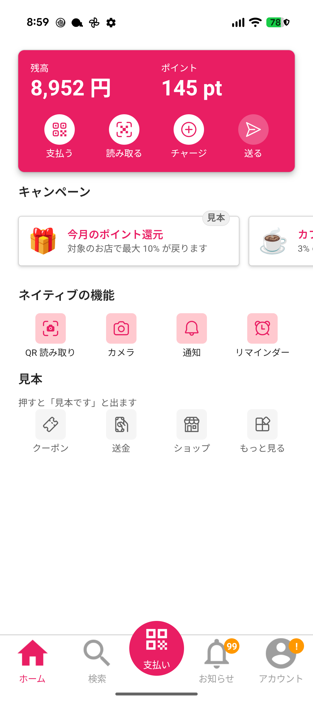
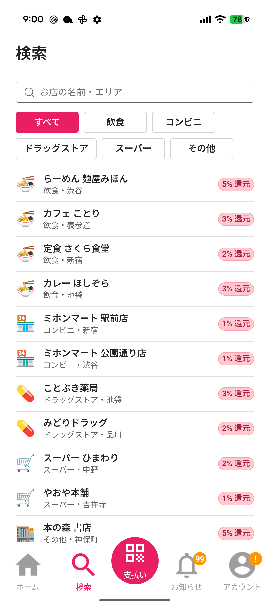
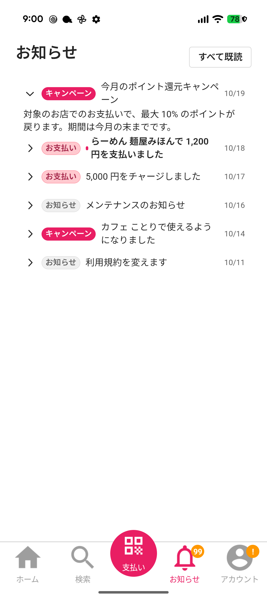
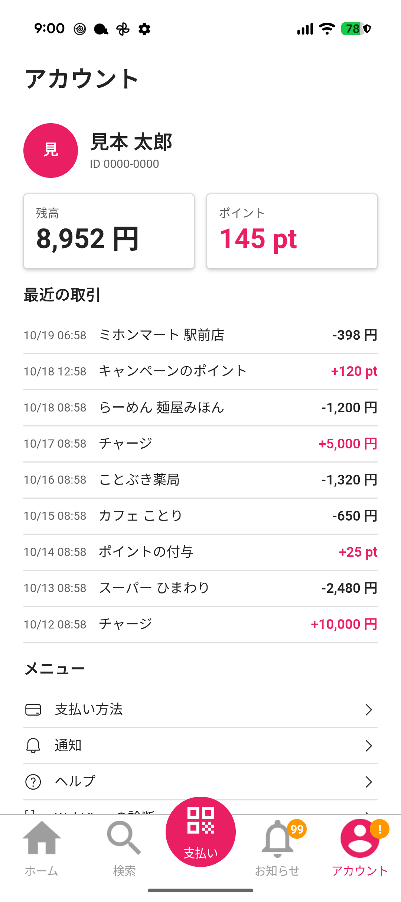
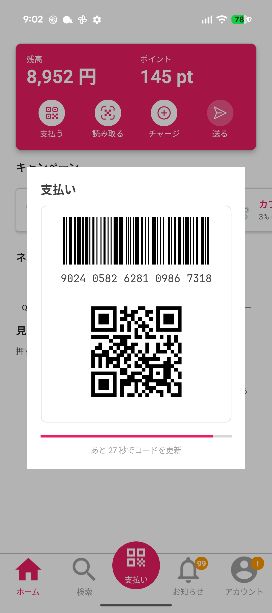
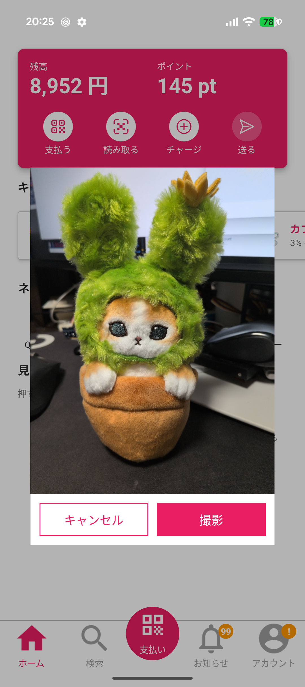

# template-maui-blazor

## 📸 Image

## ✅ Implement

| Category | Feature |
| --- | --- |
| MAUI | Style / Popup / WebView host |
| Blazor | Style (FluentUI v5) / Executing state / Back button for dialogs |
| Interop | QR / Camera / Local notification / Toast |
| Data | SQLite |

## 🔗 Ref

- [template-maui](https://github.com/usausa/template-maui)
